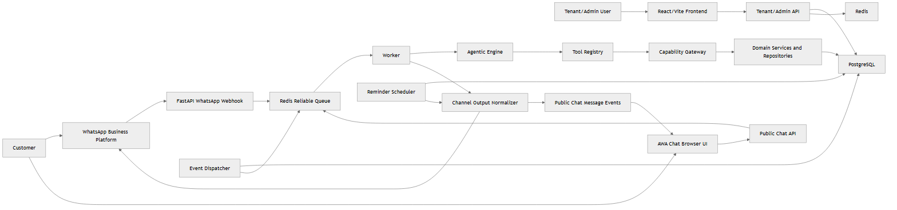
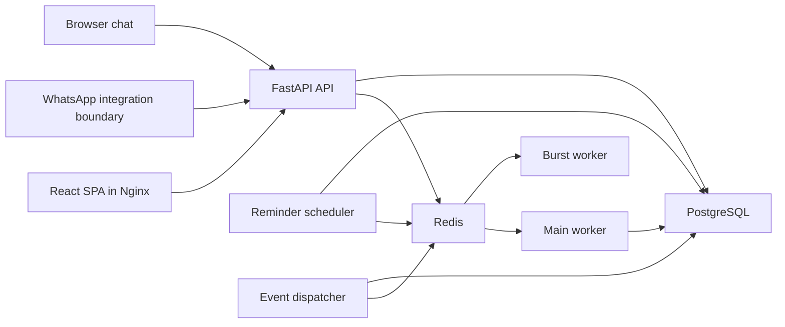
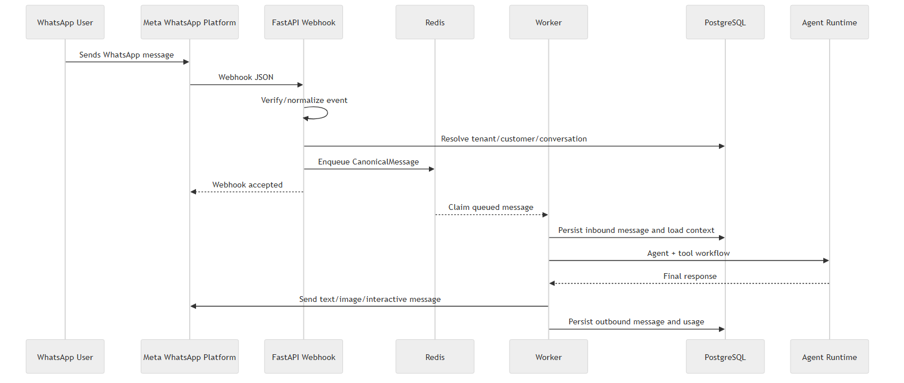
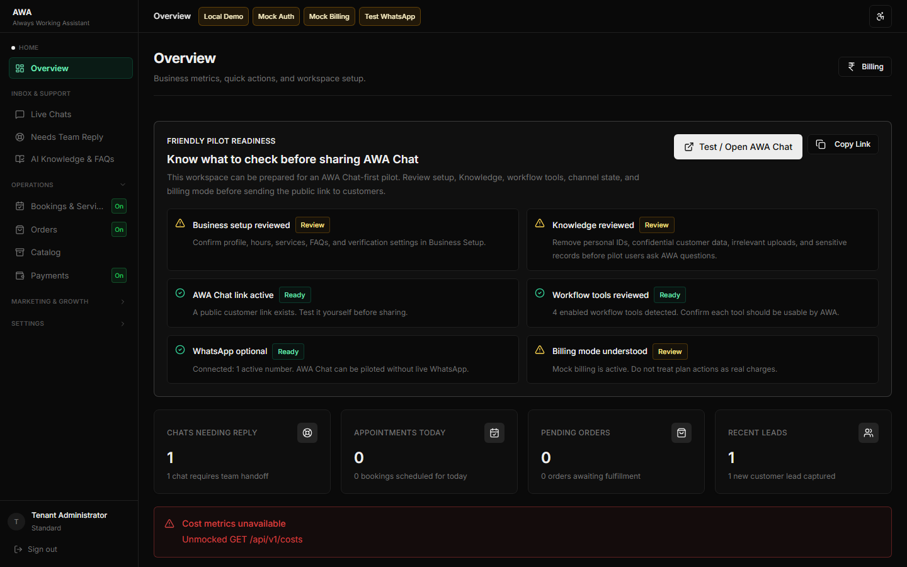
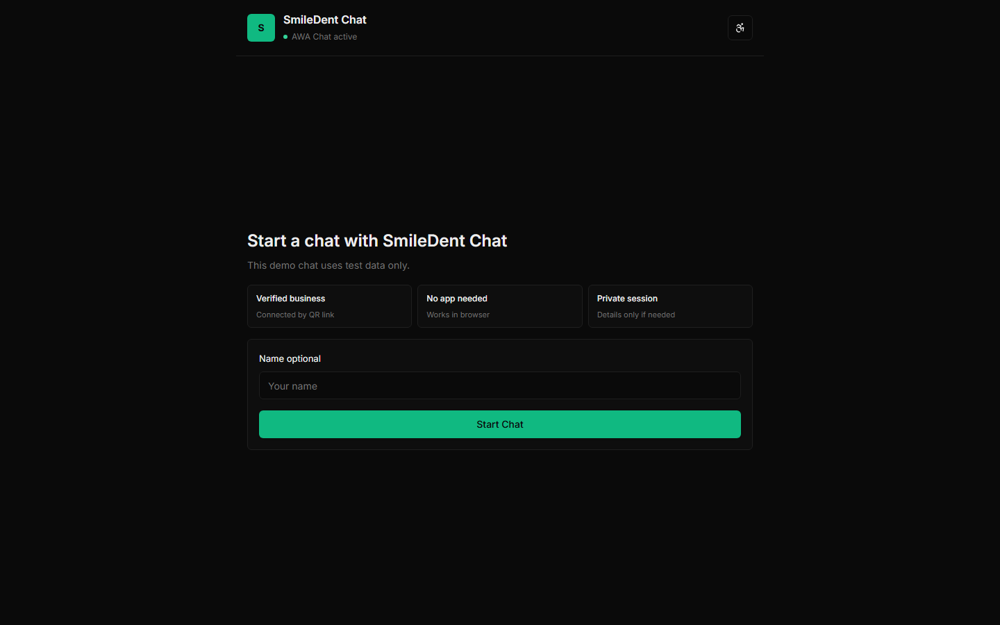
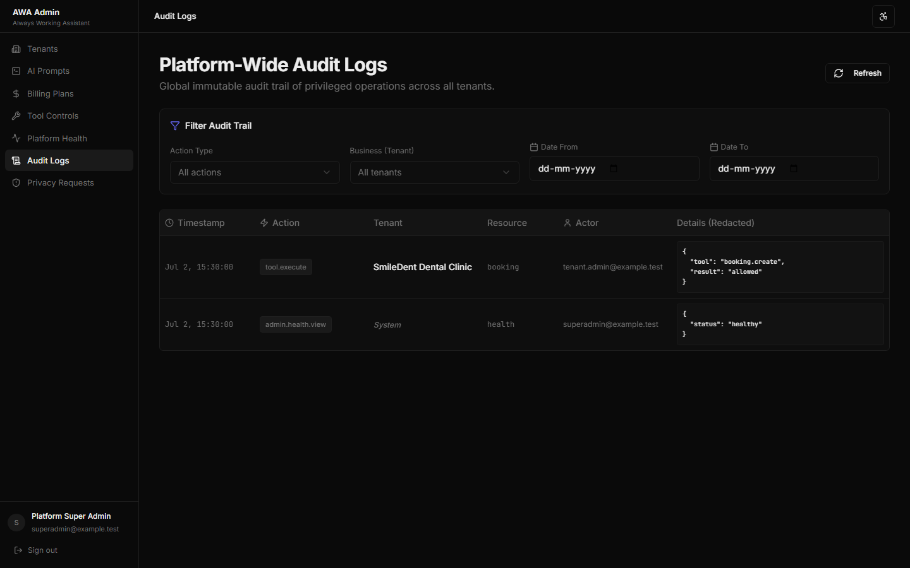
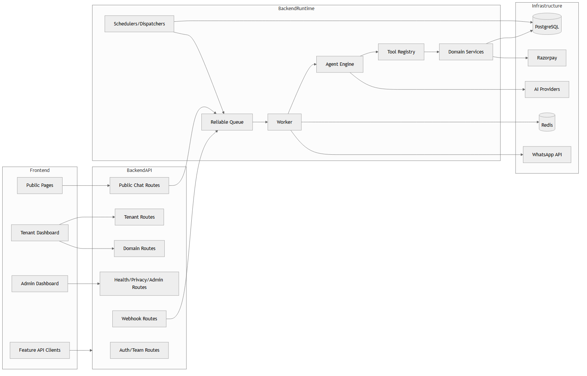

# AWA — Always Working Assistant

An open-source, full-stack, multi-tenant platform for AI-assisted customer conversation and business-workflow automation.

> **Status:** Active development · MCA major project and independent open-source initiative · No stable release · Not verified for public-production deployment · `AGPL-3.0-only` · Contributions are welcome

## Project Overview

Businesses receive repeated customer questions and service requests through browser chat and WhatsApp-oriented channels. AWA provides one configurable platform for handling those conversations and connecting them to backend-controlled business operations such as bookings, orders, leads, reviews, reminders, customer management, and support.

The AI layer assists with interpretation and response generation; it does not autonomously control business data. FastAPI services remain authoritative for validation, authorization, tenant isolation, configuration normalization, workflow state, and PostgreSQL persistence. Redis coordinates buffering, durable queue processing, retries, and workers, while human escalation remains available when automation should stop or an operator should take over.

AWA is a technical and academic project under active development. The repository is a sanitized open-source baseline intended for review, local development, and future contribution—not evidence of a stable release or verified public-production deployment.

## Project Metadata

| Field | Value |
|---|---|
| Project | AWA — Always Working Assistant |
| Project type | MCA major project, independent product, open-source project |
| Domain | Conversational AI, SaaS, business workflow automation |
| Author and maintainer | Hari R Chandran |
| Development model | Sole developer |
| Institution | Mar Thoma Institute of Information Technology, Ayoor, Kollam, Kerala |
| Backend | Python, FastAPI |
| Frontend | React, TypeScript, Vite |
| Data and coordination | PostgreSQL, Redis |
| Infrastructure | Docker Compose, Nginx |
| Main channels | Browser chat and WhatsApp-oriented integration |
| Licence | AGPL-3.0-only |
| Status | Active development; no stable public release |

## Academic Context

AWA was developed as a Master of Computer Applications (MCA) major project and also as an independent personal product and open-source initiative. Its academic identification describes the project context; it does not imply endorsement by Mar Thoma Institute of Information Technology.

The technical scope spans software engineering, AI-provider integration, distributed message processing, relational databases, tenant-aware security controls, and frontend application design. This README confines its academic context to the confirmed programme, institution, and project type.

## Problem Statement

Customer requests arrive through multiple channels, while small and medium businesses may not have continuous human availability. Rigid chatbots can lose conversational context and are often unable to perform business operations safely. Those operations require tenant-specific configuration, data validation, authorization, persistence, retries, and an auditable history.

AWA aims to combine natural conversation with deterministic backend control: the conversation layer helps understand and communicate, while tenant-aware application services decide which operations are allowed and how valid state is stored.

## Objectives

- Provide unified customer-conversation handling.
- Support configurable, tenant-owned workflows.
- Serve browser-chat and WhatsApp-oriented channels.
- Cover booking, ordering, lead, review, reminder, support, and knowledge workflows.
- Keep validation, authorization, and persistence under backend control.
- Preserve tenant isolation across application and data layers.
- Make human handoff available throughout conversation handling.
- Use durable queues and worker processes for asynchronous work.
- Abstract multiple AI providers behind common application boundaries.
- Make operation observable and testable through health, cost, audit, and test surfaces.
- Maintain an extensible open-source architecture.

These are project objectives, not a claim that every area is complete or independently verified for production.

## Target Users

- **Tenant business administrators** who configure business details, workflows, channels, staff access, and enabled tools.
- **Operators and staff** who review conversations, manage domain records, answer escalations, and return conversations to automation.
- **Customers** who interact through public browser chat or a configured WhatsApp-oriented channel.
- **Platform administrators** who manage tenants, plans, prompts, audit views, health views, privacy operations, and tool controls.
- **Developers and contributors** who want to evaluate, test, document, or extend the platform.

## My Role and Contributions

Hari R Chandran is the sole developer and project owner of AWA. The work was directed and reviewed as an independent technical and academic project.

### Product and Architecture

- Defined the product requirements, scope, acceptance criteria, multi-tenant architecture, channel boundaries, and development direction.
- Designed the API, worker, queue, configuration, domain-service, frontend, and deployment-oriented boundaries.

### Backend and Data

- Developed the FastAPI application, PostgreSQL schema and migrations, Redis coordination, authentication and authorization boundaries, domain workflows, events, and provider adapters.
- Designed tenant-aware validation, idempotency, workflow state, persistence, privacy operations, and audit paths.

### Frontend and User Experience

- Developed the React and TypeScript public, tenant, operator, and platform-administration interfaces.
- Directed navigation, forms, data tables, role-aware access, responsive layouts, and browser-chat behavior.

### AI and Conversation Workflows

- Integrated multiple AI-provider boundaries and defined how interpretation, extraction, language handling, response generation, deterministic workflows, tool controls, and escalation interact.
- Kept domain writes and protected operations behind backend validation and authorization.

### Testing, Security, and Documentation

- Defined the testing strategy, security and privacy controls, repository sanitation, contributor guidance, architecture documentation, and final validation criteria.
- Reviewed assisted changes and retained responsibility for correctness, licensing, and the published output.

## AI-Assisted Development Disclosure

AI-assisted development tools were used under the author's direction. Hari R Chandran defined the requirements, bounded implementation tasks, acceptance criteria, and release decisions, and reviewed the architecture, code changes, tests, and documentation. AI assistance does not transfer responsibility away from the author. Contributors must follow the disclosure policy in [CONTRIBUTING.md](CONTRIBUTING.md).

## Current Status and Maturity

The statuses below distinguish source availability from operational or provider verification.

| Area | Status | Notes |
|---|---|---|
| Sanitized open-source source snapshot | Implemented | A reviewed baseline with source, tests, migrations, governance files, documentation, and synthetic media is established. |
| Backend application | Implemented | FastAPI routes, tenant services, domain logic, workers, and administration surfaces are present. |
| Frontend application | Implemented | React SPA includes public, tenant, operator, and platform-administration routes. |
| PostgreSQL schema and migrations | Implemented | Tenant-aware relational schema, RLS policies, ordered migrations, and pgvector support are retained. |
| Redis queues and coordination | Implemented | Reliable queue, processing deadlines, retries, dead-letter handling, burst buffering, rate limits, and idempotency markers are present. |
| Browser chat | Implemented | Public links, signed link/session controls, contact capture, SSE where available, polling fallback, and human replies are present. |
| WhatsApp integration boundary | External configuration required | Webhook and outbound integration code exists; valid Meta credentials and deployment configuration are required, and live production behavior is not independently verified. |
| Booking | MVP / partial | Core collection, validation, idempotent creation, and dashboard operations exist; capacity, external calendars, and full reschedule/cancel automation do not. |
| Orders and catalog | MVP / partial | Order capture, DB/config catalog lookup, catalog administration, status actions, and inventory history exist; branch routing and complete stock automation remain partial. |
| Payments | MVP / partial | Payment-request and lifecycle paths exist; live customer-payment provider maturity and reconciliation are not independently verified. |
| Reminders | MVP / partial | Rules, scheduled messages, lifecycle actions, scheduler, and configured WhatsApp-oriented delivery paths exist; automatic trigger coverage and email/SMS delivery are incomplete. |
| Reviews | MVP / partial | Settings, manual requests, lifecycle actions, routing, and escalation paths exist; automatic post-service creation and complete customer chat capture remain future work. |
| Lead capture | Implemented | Configured lead fields are collected and stored in tenant-scoped customer metadata. |
| Customer management | MVP / partial | Customer profiles, metrics, tags, notes, privacy coverage, and timelines exist; merge, segmentation, and bulk actions remain future work. |
| Human escalation | Implemented | Escalation, operator replies, resolution, return to automation, and optional knowledge save are present. |
| Knowledge retrieval | MVP / partial | Tenant knowledge CRUD, embedding search when available, and lexical fallback exist; first-party website/document ingestion is not implemented. |
| Billing and usage controls | Implemented | Plan, module, mode, message, token, credit, billing-status, and administration paths are present; live provider billing remains configuration-dependent. |
| Privacy/security-oriented controls | MVP / partial | Tenant access checks, RLS, secrets validation, privacy operations, audit events, and input guardrails exist; no certification or legal-compliance guarantee is claimed. |
| Public deployment | Not independently verified | No public-production deployment has been verified. Backup, restore, monitoring, alerting, scale, and provider operations remain deployment-dependent. |
| Stable release | Not released | There is no stable version, tag, or public release. |

## Core Capabilities

### Multi-Tenant Administration

Tenant membership and roles scope API operations. Versioned tenant configuration controls business identity, working hours, services, workflows, FAQs, escalation, AI mode, and limits; platform administration exposes tenant, plan, prompt, health, audit, privacy, and tool-control surfaces.

### Customer Conversations

WhatsApp-oriented and public browser-chat inputs become canonical message events with tenant, customer, conversation, session, configuration-version, trace, and retry context. The worker preserves conversation state and routes work through deterministic workflows or a guarded concierge path.

### Browser Chat

Tenants can create public links and QR endpoints. Public sessions use slug-bound link verification and per-session controls, deliver server-sent events (SSE) where available, and use polling as a fallback and safety check. Contact capture, end-chat behavior, automation replies, and human replies are implemented.

### WhatsApp-Oriented Integration

The integration boundary covers Meta webhook verification, signed inbound processing, delivery-status updates, account setup, embedded-signup callbacks, and outbound text or interactive messages. Live behavior requires valid Meta configuration and has not been independently verified for production.

### Booking and Availability

The booking flow collects tenant-configured service, date, time, customer, and custom fields; validates formats; prevents past dates; and creates records idempotently. Calendar integration, branch-capacity enforcement, and complete automated rescheduling or cancellation are not implemented.

### Orders, Catalog, and Inventory

AWA captures item, quantity, fulfillment, and customer details, creates order and event records, and provides dashboard actions. Tenant catalog categories and items support pricing, SKU, availability, stock fields, adjustments, and inventory history. Branch-specific inventory and full reservation/decrement automation remain partial.

### Payments

Payment-request, lifecycle-event, linked-order synchronization, manual/external provider labels, and configured Razorpay payment-link paths exist. Live production payment maturity, provider reconciliation, customer webhooks, and refunds are not independently verified.

### Reminders and Follow-Ups

Tenant rules, scheduled-message records, lifecycle actions, event timelines, a scheduler, and configured WhatsApp-oriented delivery paths exist. Automatic event-to-reminder creation is incomplete, email uses a non-delivering stub, and automatic SMS delivery is not implemented.

### Reviews and Lead Capture

Review settings, private rating requests, public-review routing, lower-rating escalation, and event timelines are present, with automation gaps described above. Lead capture writes configured fields into tenant-scoped customer metadata.

### Customer Management

The CRM-oriented surface includes customer profiles, metrics, tags, internal notes, privacy export/erase coverage, and a combined customer timeline.

### Knowledge Retrieval

Configured FAQs remain in active tenant configuration. Operator-reviewed escalation answers may be saved to the tenant knowledge base and searched with embeddings when available or a lexical fallback; website and document ingestion is not implemented.

### Human Handoff

Automation can escalate a conversation to tenant operators. Operators can reply, resolve, return the conversation to AWA, and optionally save reviewed answers as tenant knowledge.

### Billing, Usage, and Tool Controls

Plan policies and usage guards constrain modes, modules, message counts, tokens, and credits. Platform tool controls update normalized tenant configuration while respecting plan-allowed modules.

### Audit, Health, Privacy, and Security-Oriented Controls

AWA includes request and trace identifiers, health and webhook-health endpoints, cost and audit views, privacy export/consent/erasure operations, tenant-aware role checks, RLS policies, production-startup validation, webhook controls, and public-chat rate limiting. These are technical controls, not a certification or guarantee of legal compliance.

## Architecture



The React and TypeScript SPA serves public pages, tenant dashboards, platform administration, and browser chat. The frontend is built into an Nginx container for the Docker-oriented local stack and communicates with the FastAPI API. PostgreSQL stores tenant, configuration, conversation, workflow, billing, and audit data; Redis coordinates burst buffering, queue claims, visibility timeouts, recovery, rate limiting, and idempotency.

The Compose topology has eight services: PostgreSQL, Redis, the FastAPI API, the main worker, burst worker, reminder scheduler, event dispatcher, and Nginx-served frontend. Browser chat enters through the public FastAPI boundary, while WhatsApp-oriented traffic enters through the Meta integration boundary.



### Runtime Message Flow

1. An inbound channel request reaches the FastAPI public-chat or WhatsApp-oriented boundary.
2. The API resolves the tenant and normalizes the request into the canonical message/event representation.
3. Redis burst buffering and the reliable queue coordinate durable processing; public chat enters the reliable queue directly.
4. The worker loads tenant configuration, customer, conversation, session, and workflow context.
5. AI-assisted or deterministic interpretation selects the bounded conversation path.
6. Backend schemas, usage guards, tenant authorization, and tool policies validate the proposed operation.
7. The relevant domain service performs the booking, order, lead, support, knowledge, reminder, review, payment, or handoff operation.
8. PostgreSQL persists domain state, messages, events, and audit context.
9. The response is stored and delivered through the configured outbound channel.
10. Retry, visibility-timeout recovery, dead-letter handling, failure recording, escalation, or audit behavior applies where defined.



The source contains these recovery paths, but this diagram does not claim that every provider or operational failure mode has been proven in public production.

## LLM-First Conversation, Deterministic Backend

AWA uses AI to assist intent interpretation, structured-field extraction, language handling, and response generation. Tenant configuration—not the model—determines the available services, required fields, enabled workflows, tool access, and operating limits.

Backend Pydantic schemas and domain services validate data types, tenant authorization, workflow state, plan and usage policy, confirmations, and persistence. Valid values are stored under the exact tenant-defined keys expected by the active configuration. Validation errors return to the conversation layer so the customer can correct the relevant value.

An active workflow should retain its state unless the customer explicitly cancels it or selects a supported switch. Protected operations remain subject to backend controls and confirmation where defined. Prompt contents and security-sensitive implementation details are intentionally not reproduced in this README.

## Technology Stack

### Backend

| Category | Technologies |
|---|---|
| Language and API | Python, FastAPI, Uvicorn |
| Validation and settings | Pydantic, pydantic-settings, JSON Schema |
| Data | asyncpg, PostgreSQL, pgvector |
| Cache and coordination | Redis |
| AI providers | OpenAI, Gemini, Groq, Ollama adapters |
| Orchestration | LangChain, LangGraph, provider SDKs |
| HTTP and security | HTTPX, Requests, PyJWT, bcrypt, cryptography, SlowAPI |
| Payments | Razorpay SDK and application-owned payment request paths |
| Testing | pytest, pytest-asyncio |

### Frontend

| Category | Technologies |
|---|---|
| Core | React, TypeScript, Vite |
| Routing and server state | React Router, TanStack Query |
| Tables and virtualization | TanStack Table, TanStack Virtual |
| Client state | Zustand |
| UI and styling | Tailwind CSS, Radix UI, shadcn-style components, Lucide |
| Forms and validation | React Hook Form, Zod |
| API and visualization | Axios, Recharts |
| End-to-end testing | Playwright |

### Infrastructure

| Area | Technologies |
|---|---|
| Containers | Docker, Docker Compose |
| Frontend serving | Nginx |
| Continuous integration | GitHub Actions |
| Local development | PowerShell helpers, npm scripts |

## Docker Services

The retained `docker-compose.yml` is a local-development topology, not a verified public-production profile.

| Service | Responsibility |
|---|---|
| `postgres` | PostgreSQL 16 with pgvector; initializes the base schema and ordered migrations and stores application data. |
| `redis` | Password-protected Redis coordination for queues, buffering, rate limits, locks, and idempotency. |
| `api` | FastAPI HTTP application for authenticated APIs, public chat, webhooks, configuration, billing, health, and privacy. |
| `worker` | Claims canonical messages, loads tenant context, executes workflows or guarded agent paths, persists results, and dispatches responses. |
| `burst-worker` | Coalesces rapid consecutive WhatsApp-oriented inputs before publishing them to the reliable queue. |
| `reminder-scheduler` | Claims due scheduled messages and invokes the currently supported delivery paths. |
| `event-dispatcher` | Claims durable business events and sends them to registered application handlers. |
| `frontend` | Builds the React SPA and serves it from Nginx, with API proxy behavior defined by the frontend container configuration. |

## Repository Structure

```text
backend/                 FastAPI, domain services, workers, schema, migrations, and tests
frontend/                React and TypeScript SPA, Nginx config, and Playwright tests
docs/                    Current architecture documentation and reviewed assets
scripts/                 Local development helpers
tenants/                 Public tenant configuration schema guidance
.github/                 CI workflow and contributor templates
docker-compose.yml       Eight-service local stack
docker-compose.dev.yml   Development overrides
README.md                Technical, academic, contribution, and portfolio overview
LICENSE                  AGPL-3.0-only licence text
CONTRIBUTING.md           Contribution and AI-assistance policy
SECURITY.md               Vulnerability reporting and deployment expectations
ROADMAP.md                Non-binding project direction
CHANGELOG.md              Unreleased change history
```

## Screenshots

The screenshots below contain synthetic demonstration data and do not represent a public deployment.

### Tenant Dashboard



### Public Chat



### Audit Logs



### System Components



## Local Development

### Prerequisites

- Git.
- Docker Desktop, or Docker Engine with Docker Compose, for the complete containerized stack.
- Node.js and npm for direct frontend development and repository scripts.
- Python 3.12 for direct backend tooling; the retained PowerShell initializer checks this version family.
- Windows PowerShell for the included development helpers. Equivalent manual commands can be derived from the manifests on other platforms.

### Clone and initialize

The repository does not yet have a public remote. Replace both placeholders after a public repository exists:

```powershell
git clone <repository-url>
cd <repository-directory>
Copy-Item .env.example .env
```

Edit `.env` and replace every placeholder before starting. For direct host-mode development, `npm run init` also creates `backend/.env.local`, creates the Python virtual environment, and installs backend and frontend dependencies:

```powershell
npm run init
npm run dev
```

`npm run dev` starts the FastAPI API, React development server, main worker, burst worker, and reminder scheduler. It expects accessible PostgreSQL and Redis instances and does not start Redis itself.

### Docker-oriented startup

After configuring the root `.env`, start the eight-service local stack with:

```powershell
npm run docker:up
```

The frontend is published at `http://127.0.0.1:5173` and the API at `http://127.0.0.1:8000` by the retained Compose configuration. Stop the stack with `npm run docker:down`.

## Configuration

Copy [.env.example](.env.example) to `.env` for Docker Compose. The PowerShell initializer also copies it to `backend/.env.local` for host-mode backend processes. Replace every placeholder and use only local or test credentials.

- Host-mode `DATABASE_URL` and `REDIS_URL` values use `127.0.0.1`; containers override those URLs with the internal service names `postgres` and `redis`.
- `.env` files do not recursively interpolate variables. Enter complete URLs, including matching database or Redis passwords, rather than referencing another variable inside the URL.
- Docker Compose performs its own `.env` interpolation; it is not a general application configuration loader. Review special characters and Compose escaping rules when generating local values.
- Never commit `.env` or `backend/.env.local`.
- Public chat uses separate `PUBLIC_CHAT_LINK_SECRET` and `PUBLIC_CHAT_SESSION_SECRET` values; generate strong, independent secrets without publishing them.
- Mock flags and bypasses must remain disabled for production-oriented deployments.
- Live Meta, Razorpay, CAPTCHA/OTP, and AI-provider paths require their own credentials and deployment configuration.
- Any real deployment requires an independent security, privacy, retention, backup, monitoring, and legal review.

## Common Commands

These commands are present in repository manifests; this documentation task did not execute them.

| Command | Purpose |
|---|---|
| `npm run init` | Create the local Python environment and install backend/frontend dependencies through the PowerShell helper. |
| `npm run dev` | Start direct host-mode API, frontend, and worker processes. |
| `npm run test:backend` | Run the backend pytest suite using the local virtual environment. |
| `npm run lint` | Run frontend ESLint. |
| `npm run build` | Run the TypeScript and Vite frontend build. |
| `docker compose config --quiet` | Validate Compose interpolation and structure after `.env` is configured. |

The frontend also defines `npm --prefix frontend run test:e2e` for Playwright E2E tests.

## Testing and Validation

The repository contains a backend pytest suite, frontend lint and TypeScript/Vite build checks, Playwright browser E2E tests, Compose configuration validation, migration-path validation, and a GitHub Actions workflow that covers database migrations, backend tests, lint, and build steps.

During preparation of the sanitized baseline, pytest successfully collected **2,475 tests**. This confirms collection coherence, not that the complete suite has passed on the final publication commit. Full dependency-backed results will be verified before publication.

No coverage percentage, complete-suite pass total, public-production performance result, accuracy metric, or scale benchmark is claimed.

## Security and Privacy

- Working secrets and private configuration are excluded; `.env` files are ignored and must not be committed.
- The four reviewed screenshots use synthetic demonstration data; the two architecture assets are explanatory diagrams and expose no customer data.
- API dependencies, configuration versions, database RLS policies, and domain validation provide tenant-aware access and persistence boundaries.
- Mock, test, and live modes are separated, with production-startup checks for unsafe combinations and weak or missing secrets.
- Public-chat link/session controls, rate limiting, webhook signature paths, replay checks, audit events, privacy operations, and prompt/config guardrails are implemented where documented.
- Security vulnerabilities must follow [SECURITY.md](SECURITY.md) and must not be submitted as public issues.
- Deployment operators remain responsible for secrets, network controls, provider configuration, backups, retention, monitoring, incident response, and applicable legal obligations.

No security certification, legal-compliance guarantee, or assurance that a deployment is fully secure is claimed.

## Known Limitations

- There is no stable release.
- There is no verified public-production deployment.
- No performance, uptime, scale, or accuracy benchmark is claimed.
- External credentials and configuration are required for live providers.
- Live WhatsApp configuration has not been independently verified for production.
- Live customer-payment operation has not been independently verified.
- Automatic email and SMS reminder delivery is not implemented.
- Operational backup, restore, alerting, and paging remain deployment-dependent.
- Compliance depends on deployment, organizational policy, jurisdiction, retention, and external providers; no certification is claimed.
- Architecture and APIs may change before the first stable release.

## Open-Source Licence

Copyright © 2026 Hari R Chandran.

AWA is licensed under the GNU Affero General Public License version 3 only (`AGPL-3.0-only`). See [LICENSE](LICENSE).

In general, the AGPL requires operators of network-deployed modified versions to make the corresponding source available under its terms. Review the licence text for the exact obligations; this summary is not legal advice.

## Contributing

Contributions are welcome while AWA is under active development. Read [CONTRIBUTING.md](CONTRIBUTING.md), [CODE_OF_CONDUCT.md](CODE_OF_CONDUCT.md), [SECURITY.md](SECURITY.md), and [ROADMAP.md](ROADMAP.md) before opening a change.

Useful contribution areas include bug fixes, tests, documentation, accessibility, internationalization, frontend usability, provider adapters, deployment guidance, observability, performance measurement, security hardening, and reproducible developer tooling. Material AI assistance must be disclosed as described in the contribution policy. Security vulnerabilities must not be reported through public issues.

## Other Selected Projects

**The following are independent projects by the same author. They are not AWA modules.**

| Project | Domain | Description |
|---|---|---|
| [UGC NET Cracker](https://github.com/Harirchandran/UGC_NET_Cracker) | EdTech, offline PWA, AI-assisted study | Offline-first UGC-NET preparation platform with a structured question bank and optional AI assistance. |
| [Multi-Source RAG](https://github.com/Harirchandran/multi-source_RAG) | Retrieval-augmented generation | Document and URL ingestion with local embeddings, FAISS retrieval, reranking, and LLM generation. |
| [Job Recommendation System](https://github.com/Harirchandran/job_recommendation_system) | Django, NLP, recommendation | Candidate and company workflow with résumé parsing and skill-based matching. |
| [YOLO Behaviour Detection](https://github.com/Harirchandran/yolo-behaviour-detection) | Computer vision | YOLO-based safety and behaviour-detection experimentation for image, video, and webcam inputs. |

These portfolio entries are not represented as complete or production-ready.

## Documentation

Current, source-aligned architecture documentation:

- [System overview](docs/architecture/current/system-overview.md) — deployed components, high-level flow, product areas, gaps, modes, and maturity.
- [Runtime pipeline](docs/architecture/current/runtime-pipeline.md) — canonical messages, queues, worker behavior, intent/workflow state, knowledge, and dispatch.
- [API contract](docs/architecture/current/api-contract.md) — response envelope, authentication roles, and live route inventory.
- [Data model](docs/architecture/current/data-model.md) — tenancy, conversations, domain records, constraints, RLS, and migrations.
- [Feature modules](docs/architecture/current/feature-modules.md) — implemented scope and future work for each domain module.
- [Frontend contract](docs/architecture/current/frontend-contract.md) — routes, role guards, API behavior, feature surfaces, and gaps.
- [Tenant config contract](docs/architecture/current/tenant-config-contract.md) — normalized configuration, module keys, workflows, AI modes, and versioning.
- [Security and operations](docs/architecture/current/security-operations.md) — runtime safety, authorization, webhooks, public chat, privacy, and deployment responsibilities.

## Roadmap

Planned work focuses on contributor readiness, reproducible dependency-backed validation, CI repair, release engineering, security hardening, deployment guidance, observability, provider abstraction, accessibility, localization, and measured performance work. Roadmap items are proposals, not delivery commitments. See [ROADMAP.md](ROADMAP.md).

## Author and Maintainer

**Hari R Chandran**<br>
MCA final-year student<br>
Mar Thoma Institute of Information Technology, Ayoor, Kollam, Kerala<br>
GitHub: [@Harirchandran](https://github.com/Harirchandran)

## Acknowledgements

AWA builds on open-source libraries and frameworks across the Python, FastAPI, PostgreSQL, Redis, React, TypeScript, Docker, and AI-provider ecosystems. Community contributors will be acknowledged when contributions exist. AI-assisted development is disclosed transparently, with final direction, review, validation, and responsibility retained by the author.
