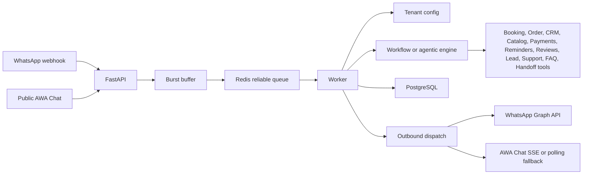

# AWA — Always Working Assistant: Current System Overview
Last aligned with the codebase on 2026-08-04.
AWA — Always Working Assistant is a multi-tenant WhatsApp and browser-chat application. The implemented system includes tenant onboarding, WhatsApp account setup, public AWA Chat links, conversation handling, booking and order modules, CRM Lite, catalog/inventory, payment/deposit tracking, reminders/follow-ups, review collection, human escalation, knowledge-base search, billing limits, admin controls, and a React dashboard.
## Running Services
| Service | Code location | Responsibility |
| --- | --- | --- |
| React SPA | `frontend/` | Public marketing/auth pages, tenant dashboard, admin dashboard, public AWA Chat client. |
| FastAPI API | `backend/api/` | Authenticated tenant/admin APIs, public chat APIs, webhooks, config, billing, privacy. |
| PostgreSQL | `backend/db/sql/` | Tenant data, conversations, messages, bookings, orders, configs, audit logs, RLS. |
| Redis | `backend/pipeline/` | Burst buffering, reliable message queue, public chat rate limits, idempotency markers. |
| Worker | `backend/pipeline/worker.py` | Canonical message processing, workflow/agent execution, tool calls, outbound dispatch. |
| Burst worker | `backend/pipeline/burst_worker.py` | Coalesces fast consecutive customer messages before enqueueing. |
| Reminder scheduler | `backend/pipeline/reminder_scheduler.py` | Claims due scheduled messages and handles supported delivery paths. |
| Event dispatcher | `backend/pipeline/event_dispatcher.py` | Claims and dispatches business events to registered handlers. |
| WhatsApp Graph integration | `backend/integrations/meta_whatsapp.py`, `backend/api/whatsapp_client.py`, and `backend/api/webhook.py` | Meta webhook verification, inbound messages, outbound text/interactive sends. |
| Razorpay integration | `backend/billing/` and `backend/api/webhook.py` | Subscription status, plan checks, webhook ingestion. |
`docker-compose.yml` retains the `postgres`, `redis`, `api`, `worker`, `burst-worker`, `reminder-scheduler`, `event-dispatcher`, and `frontend` services. PostgreSQL, Redis, the API, and the frontend use localhost-only published ports for host access; containers connect through the internal service names `postgres` and `redis`.
## High-Level Flow

## Implemented Product Areas
| Area | Current status |
| --- | --- |
| Tenant auth and roles | Implemented with selectable auth modes, DB-backed tenant role checks, and route guards. Audited production configuration requires backend-owned PostgreSQL auth and rejects Supabase or mock auth. |
| WhatsApp integration | Implemented for webhook verification, message ingestion, status handling, account setup, embedded signup callback, and outbound messages. |
| AWA Chat | Implemented as a first-party public browser channel with link management, QR SVG endpoints, session tokens, SSE where available with polling fallback, and contact capture. |
| Booking module | Implemented for service/date/time/name collection, validation, idempotent booking creation, dashboard listing, and tenant config. |
| Order module | Implemented for catalog-backed item selection, quantity, fulfillment, customer details, idempotent order creation, order dashboard, and catalog/rules editing. |
| CRM Lite | Implemented for customer metrics, tags, internal notes, privacy coverage, timeline APIs, and customer dashboard tabs. |
| Catalog and inventory | Implemented for tenant categories/items, price/SKU/availability/stock fields, stock adjustments, inventory event history, and order execution lookup. |
| Payments and deposits | Implemented for tenant payment requests, lifecycle actions, manual/external provider tracking, linked order payment sync, and dashboard management. Payment-provider paths are not independently verified as production-ready. |
| Reminders and follow-ups | Implemented MVP for reminder rules, scheduled messages, lifecycle actions, event timelines, WhatsApp delivery paths, and dashboard management. Email and SMS delivery are not implemented. |
| Review collection | Implemented MVP for review settings, manual/private rating requests, public-review routing, negative-feedback escalation, event timelines, and dashboard management. |
| Escalation workflow | Implemented for manual escalation, human replies, return-to-automation, resolution, optional knowledge save, and AWA Chat delivery fallback. |
| Knowledge base | Implemented with tenant CRUD, enabled flag, embedding search when available, and lexical fallback. |
| Billing and limits | Implemented with plan policies, usage guard, daily/monthly counters, Razorpay plan sync, admin overrides, and billing event views. |
| Admin dashboard | Implemented for tenants, prompts, billing plans, tool controls, health, audit, and privacy views. |
## Important Gaps And Future Work
These are real gaps in the current codebase, not missing documentation:
| Gap | Current behavior |
| --- | --- |
| Booking availability engine | Booking validates date/time format and prevents past dates, but does not yet reserve against a calendar or branch capacity system. |
| Reminder delivery coverage | The scheduler claims due messages and supports configured WhatsApp delivery. Email uses a non-delivering stub, SMS is not connected, and automatic trigger creation remains incomplete. |
| Review automation | Review settings and requests are implemented, but automatic creation after completed bookings/orders and customer chat rating capture are future work. |
| Branch operations APIs | Schema contains branches, but branch-specific booking/order routing is not exposed as a full product workflow. |
| Catalog workflow loading | DB catalog tables exist and order execution can look them up, but workflow option collection still primarily uses config catalog prompts. |
| Live chat transport | Public chat uses SSE where available, with polling fallback. WebSocket transport is not implemented. |
| CAPTCHA/OTP for public chat | Configurable Turnstile and phone-possession verification paths exist; live behavior depends on external credentials, endpoints, and deployment configuration. |
| Metrics and alerting | Health/cost/audit APIs exist, but production-grade metrics dashboards and alert rules are outside this repo. |
## Current Modes
Integration mode is controlled by environment variables in `backend/core/config.py`:
| Mode variable | Purpose |
| --- | --- |
| `AWA_INTEGRATION_MODE` | Global `mock`, `test`, or `live` mode. |
| `AUTH_MODE` | Auth service override. |
| `WHATSAPP_MODE` | WhatsApp integration override. |
| `BILLING_MODE` | Billing integration override. |
| `ROUTING_LLM_PROVIDER` | Deterministic routing/intent LLM provider when used. |
| `AGENT_LLM_PROVIDER` | Concierge agent provider. |
Production startup rejects unsafe combinations such as mock/live mismatches, weak public-chat secrets, missing required secrets, and wildcard CORS.

## Operational Maturity

There is no verified public production deployment, uptime guarantee, or compliance certification represented by this repository. Live provider behavior depends on external credentials and configuration, and payment-provider paths have not been independently verified as production-ready.
